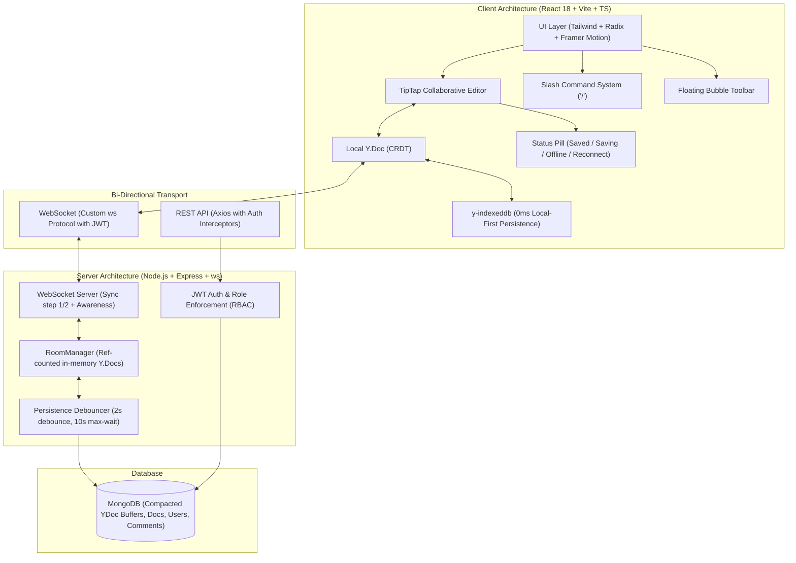

# Velum — Real-Time Collaborative Document Studio

> A product-studio grade collaborative editor engineered with **React 18 + Vite + TypeScript**, **Tailwind CSS + Radix UI + Framer Motion**, **TipTap + Yjs CRDTs**, **Node.js/Express + ws**, and **MongoDB**.

---

## 🏛 Architecture Diagram



---

## 🚀 Key Features Shipped

1. **Non-Negotiable Product Principles**:
   - **Never make the user wait**: Optimistic mutations, zero-wait loading from IndexedDB, layout skeletons with identical footprints to prevent CLS.
   - **Never lose a keystroke**: Local-first persistence writes to device storage before network transit; background reconnection automatically reconciles.
   - **Never surprise the user**: No cursor jumps, no viewport scrolls when peers type; remote changes feature a gentle 600ms soft tint fade.
   - **Show the truth, quietly**: Debounced `StatusPill` with Saved, Saving, Offline, Reconnecting, and Read-only states.
   - **Keyboard-first**: Universal Command Palette (`⌘K`), Shortcuts Sheet (`⌘/`), Find & Replace (`⌘F`), and Slash Menu (`/`).

2. **Design System & Primitives (`/design`)**:
   - Curated HSL tokens for slate-cool light and dark themes.
   - 12 curated, accessible collaborator cursor colors auto-assigned per peer.
   - Layered elevation shadows and backdrop-blur glassmorphism.
   - Full component suite: `Button`, `IconButton`, `Input`, `Textarea`, `Switch`, `Checkbox`, `Tabs`, `Avatar`, `AvatarStack`, `Badge`, `Kbd`, `Popover`, `DropdownMenu`, `ContextMenu`, `Dialog`, `Sonner Toast`, `CommandPalette`, `Skeleton`, `EmptyState`, `Spinner`, `SegmentedControl`, `ColorSwatchPicker`.

3. **Centerpiece Collaborative Editor**:
   - TipTap ProseMirror engine supporting Headings H1-H3, Bold, Italic, Underline, Strike, Highlight, Inline Code, Code Block with syntax highlighting, Callouts, Tables with hover handles, Task lists, Quotes, and Dividers.
   - Sticky `FixedToolbar` with font switcher (Inter, Newsreader serif, JetBrains Mono).
   - Floating `BubbleToolbar` on text selection with Comment CTA (`⌘⌥M`).
   - Grouped `SlashMenu` on `/` with fuzzy search and arrow navigation.
   - Headings `OutlineSidebar` with scroll-spy navigation.
   - Collapsible Right Panel with:
     - **Comments**: Threads, anchored selections, @mentions, emoji reactions, and reply chains.
     - **Version History**: Grouped milestones, `diff-match-patch` visualizer with green additions and red deletions, reversible restoration with Undo toast.
     - **Document Stats**: Live word count, character count, and estimated reading time.

4. **Multi-User Collaboration & Presence**:
   - Real-time peers list in the header avatar stack.
   - Smoothly interpolated 2px carets with author name flags.
   - Follow mode: smooth viewport tracking of remote collaborators.
   - Server-side RBAC: viewers cannot overwrite documents; live permission changes downgrade connected clients in real time.

---

## 🛠 Local Setup & Running

### Prerequisites
- Node.js 18+
- MongoDB running on `mongodb://127.0.0.1:27017` (built-in hybrid fallback supported if MongoDB is offline)

### Commands
```bash
# 1. Install all dependencies across monorepo
npm run install:all

# 2. Run both server and client concurrently
npm run dev

# Or run separately:
npm run dev --prefix server   # Runs on http://localhost:5000 (WS: ws://localhost:5000/ws)
npm run dev --prefix client   # Runs on http://localhost:5174
```

### Direct URLs
- **Web App**: `http://localhost:5174/`
- **Component Showcase**: `http://localhost:5174/design`
- **Dashboard**: `http://localhost:5174/dashboard`
- **Backend Health**: `http://localhost:5000/health`
